# ESP32-based NFC Terminal

Standalone access-control terminal built on an **ESP32**. It reads NFC cards
(ISO 14443A UID) with a **PN532**, asks a remote server over **HTTPS** whether
the card is allowed, and shows the result on an **ILI9341** colour display and
an **RGB LED**. The network link is **W5500 Ethernet** by default; on-chip Wi-Fi
is a build option.

Firmware version: **1.1.0** (FreeRTOS, Arduino core for ESP32 3.x).

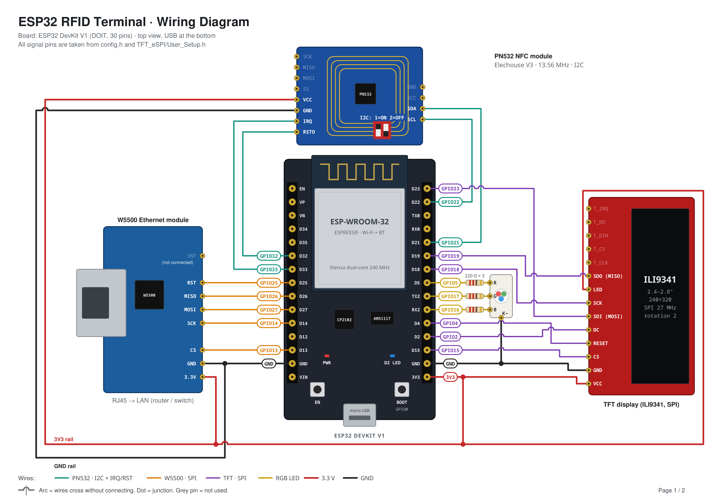

---

## Contents

- [Features](#features)
- [Hardware](#hardware)
- [Wiring](#wiring)
- [Repository layout](#repository-layout)
- [Building and flashing](#building-and-flashing)
- [Build options](#build-options)
- [First start and provisioning](#first-start-and-provisioning)
- [How a card is checked](#how-a-card-is-checked)
- [Network loss and recovery](#network-loss-and-recovery)
- [Display and LED states](#display-and-led-states)
- [BOOT button](#boot-button)
- [Local HTTP API](#local-http-api)
- [Server contract (`check_card`)](#server-contract-check_card)
- [Signed OTA updates](#signed-ota-updates)
- [NFC Terminal Manager (configuration and test app)](#nfc-terminal-manager-configuration-and-test-app)
- [Firmware architecture](#firmware-architecture)
- [Security](#security)
- [Tests](#tests)
- [Checks after flashing](#checks-after-flashing)
- [Troubleshooting](#troubleshooting)
- [License](#license)

---

## Features

- **Non-blocking FreeRTOS design.** Five tasks, each the only owner of its
  driver. A slow server or TLS handshake never freezes the display, the card
  reader or the local API.
- **UID-aware card latch.** A card is processed once per tap. A *different*
  card is accepted right away; the same card again only after it was removed.
- **Verified TLS.** Uses the built-in Mozilla CA bundle, or a CA you provision
  (`ca_cert`). `setInsecure()` is not used.
- **Physical-presence provisioning.** First setup needs a one-time code shown on
  the terminal's display. Later changes need the current `barrier` secret.
- **Brute-force protection.** 5 failed authentications lock the API for 60 s.
- **Signed OTA.** Firmware images are checked with ECDSA P-256 / SHA-256 before
  the boot partition changes.
- **Per-unit identity.** Serial and unique numbers are derived from the chip's
  factory MAC.
- **Self-healing.** A cable plugged in at any time is picked up automatically.
  Without an IP address the W5500 is restarted every 30 s; an unreachable
  server is re-checked every 15 s. PN532 health check every 30 s with re-init,
  and a 30 s task watchdog on every task.
- **Diagnostics.** `/diag` reports counters, request latency, free heap and
  per-task stack margins.
- **Upgrade path.** Configuration from firmware 1.0.x (EEPROM) moves to NVS
  automatically on first boot.

## Hardware

| Part | Notes |
|---|---|
| ESP32 DevKit V1 (DOIT, 30 pins), ESP-WROOM-32 | WROVER modules use GPIO16/17 for PSRAM, so the LED's G/B would not work there |
| PN532 NFC module (Elechouse V3, 13.56 MHz) | I2C mode: DIP switch **1 = ON, 2 = OFF**; address `0x24`, 100 kHz |
| W5500 Ethernet module | Own HSPI bus; draws up to ~130 mA |
| ILI9341 TFT, 2.4–2.8", 240×320 | VSPI, 27 MHz, rotation 2; touch not used; backlight always on |
| RGB LED, common cathode | 3 × 220–330 Ω resistors |
| BOOT button | The one already on the DevKit (GPIO0) |

All modules are powered from **3V3**. Do **not** connect the W5500 to VIN (5 V
from USB). If the board resets by itself under load, use a separate 3.3 V
supply with a common GND.

## Wiring

The diagram above is also available as a vector PDF:
[`diagram/ESP32_wiring_diagram.pdf`](diagram/ESP32_wiring_diagram.pdf).
The pin map is defined in [`firmware/nfc_terminal/config.h`](firmware/nfc_terminal/config.h)
and [`firmware/tools/User_Setup.h`](firmware/tools/User_Setup.h).

| Module pin | Board label | GPIO | Firmware name | Notes |
|---|---|---|---|---|
| **PN532 (I2C)** | | | | |
| SDA | D21 | 21 | `PIN_PN532_SDA` | |
| SCL | D22 | 22 | `PIN_PN532_SCL` | |
| IRQ | D33 | 33 | `PIN_PN532_IRQ` | Required: the library uses it to know data is ready |
| RSTO / RST | D32 | 32 | `PIN_PN532_RESET` | |
| VCC / GND | 3V3 / GND | | | |
| **W5500 (HSPI)** | | | | |
| MISO | D26 | 26 | `PIN_W5500_MISO` | |
| MOSI | D27 | 27 | `PIN_W5500_MOSI` | |
| SCK | D14 | 14 | `PIN_W5500_SCK` | |
| CS / SCS | D13 | 13 | `PIN_W5500_CS` | |
| RST | D25 | 25 | `PIN_W5500_RST` | Must be output-capable (not GPIO34–39) |
| INT | — | — | `PIN_W5500_INT = -1` | Not connected |
| 3.3V / GND | 3V3 / GND | | | Never VIN |
| **ILI9341 TFT (VSPI)** | | | | |
| SDI (MOSI) | D23 | 23 | `TFT_MOSI` | |
| SDO (MISO) | D19 | 19 | `TFT_MISO` | |
| SCK | D18 | 18 | `TFT_SCLK` | |
| CS | D15 | 15 | `TFT_CS` | |
| DC | D2 | 2 | `TFT_DC` | The board's blue LED is on this pin and will flicker |
| RESET | D4 | 4 | `TFT_RST` | |
| LED / VCC / GND | 3V3 / 3V3 / GND | | | |
| **RGB LED (common cathode)** | | | | |
| R | D5 | 5 | `PIN_LED_R` | via 220–330 Ω |
| G | TX2 | 17 | `PIN_LED_G` | via 220–330 Ω |
| B | RX2 | 16 | `PIN_LED_B` | via 220–330 Ω |
| K (long leg) | GND | | `RGB_COMMON_ANODE = false` | |
| **Button** | | | | |
| BOOT | BOOT | 0 | `PIN_BOOT_BUTTON` | On the board |

## Repository layout

```
.
├── README.md                  this file
├── LICENSE                    MIT
├── diagram/
│   ├── ESP32_wiring_diagram.pdf   wiring diagram (vector)
│   └── wiring_page1.png       the same diagram as an image
├── images/                    display screens (200×200, 24-bit BMP) for LittleFS
├── docs/screens/              the same screens as PNG, for this README
├── docs/display/              every display state, rendered (240×320)
├── docs/app/                  screenshots of the web app
├── app/                       NFC Terminal Manager (React + Tailwind + Node.js)
└── firmware/
    ├── README.md              short technical notes for 1.1.0
    ├── nfc_terminal/          Arduino sketch (open this folder)
    │   ├── nfc_terminal.ino   setup(): init, starts the five tasks
    │   ├── config.h           build options, pins, timing, task sizes
    │   ├── app_state.h/.cpp   shared state, queues, config mutex, identity
    │   ├── nfc_task.cpp       PN532 polling + card latch
    │   ├── net_task.cpp       check_card over HTTPS
    │   ├── api_task.cpp       local HTTP API + OTA
    │   ├── ui_task.cpp        display + RGB LED
    │   ├── sys_task.cpp       BOOT button, restarts
    │   ├── network.cpp        W5500 / Wi-Fi bring-up
    │   ├── storage.cpp        NVS + 1.0.x EEPROM migration
    │   ├── card_latch.h       pure C++ latch (host-testable)
    │   └── provisioning.h     pure C++ validation / OTP / throttle (host-testable)
    ├── tests/                 host-side tests, their last logs, latch model (latch_sim.py)
    └── tools/
        ├── User_Setup.h       TFT_eSPI pin setup
        ├── make_images.py         generates boot logo, brand and network / setup screens
        ├── render_screens.py     renders docs/display/ (all display states)
        └── ota_sign_and_upload.sh
```

## Building and flashing

**Toolchain:** Arduino IDE 2 or `arduino-cli`, board **ESP32 Dev Module**,
core **arduino-esp32 3.x** (tested with 3.3.12).

**Libraries:**

| Library | Notes |
|---|---|
| TFT_eSPI | Use [`firmware/tools/User_Setup.h`](firmware/tools/User_Setup.h) as the library's `User_Setup.h` |
| Adafruit PN532 | |
| Adafruit BusIO | |
| ArduinoJson | Version 7 |

**Steps:**

1. Open the folder `firmware/nfc_terminal/`. Every `.cpp`/`.h` file in it is
   part of the sketch.
2. Optional: set the options in `config.h` (see [Build options](#build-options)).
3. Optional: put your OTA public key in `api_task.cpp` (see
   [Signed OTA updates](#signed-ota-updates)). With an empty key, OTA is off.
4. Select a partition scheme that has **OTA** and **LittleFS/SPIFFS**. The Wi-Fi
   build uses ~95 % of the default 1.25 MB app slot. If you add code, choose a
   scheme with a bigger app slot that still has OTA.
5. Upload the sketch.
6. Upload the screens to LittleFS: copy `images/*.bmp` into
   `firmware/nfc_terminal/data/`, then run **Upload LittleFS to Pico/ESP8266/ESP32**
   (the [arduino-littlefs-upload](https://github.com/earlephilhower/arduino-littlefs-upload)
   plugin, `Ctrl+Shift+P`). The files must end up in the file-system root
   (`/boot_logo.bmp`, `/status_*.bmp`). The firmware never formats LittleFS
   by itself, so a failed mount cannot erase the screens. If a newer screen
   (e.g. `status_setup.bmp`) is missing, the generic `status_unknown.bmp` is
   shown instead.

With `arduino-cli`:

```bash
arduino-cli compile --fqbn esp32:esp32:esp32 --output-dir build firmware/nfc_terminal
arduino-cli upload  --fqbn esp32:esp32:esp32 -p /dev/ttyUSB0 --input-dir build firmware/nfc_terminal
```

LittleFS image from the command line (default partition table: `spiffs` at
`0x290000`, size `0x160000`; tools from `~/.arduino15/packages/esp32/tools/`):

```bash
mkdir -p build/littlefs_data && cp images/*.bmp build/littlefs_data/
mklittlefs -c build/littlefs_data -b 4096 -p 256 -s 0x160000 build/littlefs.bin
esptool --chip esp32 --port /dev/ttyUSB0 --baud 921600 write-flash 0x290000 build/littlefs.bin
```

Serial monitor: **115200** baud.

## Build options

Set in [`config.h`](firmware/nfc_terminal/config.h) or as compiler `-D` flags.

| Option | Default | Meaning |
|---|---|---|
| `USE_W5500` | `1` | `1` = W5500 Ethernet, `0` = on-chip Wi-Fi |
| `ALLOW_PLAIN_HTTP` | **`0`** | `1` = also accept `http://` server URLs. `x-api-key` and `Authorization` are then sent in clear text. Development / isolated LAN only |
| `MEASURE_LOG` | `0` | `1` = print `M,...` timing lines on serial (poll results, request latency) |

Other useful constants in `config.h`:

| Constant | Value | Meaning |
|---|---|---|
| `NFC_POLL_TIMEOUT_MS` | 250 | One PN532 poll |
| `CARD_MISS_THRESHOLD` (K) | 3 | Empty polls before the same card counts as removed |
| `HTTP_TIMEOUT_MS` | 5000 | Connect and response timeout |
| `TLS_HANDSHAKE_TIMEOUT_S` | 10 | |
| `RESULT_HOLD_MS` | 2500 | How long a result stays on the display |
| `PROVISION_WINDOW_MS` | 120000 | Lifetime of the one-time setup code |
| `AUTH_MAX_FAILURES` / `AUTH_LOCKOUT_MS` | 5 / 60000 | Brute-force lock-out |
| `NET_RECOVERY_MS` | 30000 | No IP this long → restart the W5500 (repeated) |
| `SERVER_RETRY_MS` | 15000 | Probe interval while the server is unreachable |
| `SERVER_PROBE_TIMEOUT_MS` | 3000 | TCP connect timeout of one probe |
| `NET_STALL_RESTART_MS` | 300000 | Link up but server unreachable this long → restart the W5500 |
| `WDT_TIMEOUT_MS` | 30000 | Task watchdog |

## First start and provisioning

After flashing, the RGB LED runs a self-test (red, green, blue, white), the
boot logo appears, and the terminal gets an IP address by DHCP. The IP is shown
in the display footer. An unconfigured terminal shows **Needs Config (App)**.

The terminal needs three values: `url` (the server endpoint), `api_key`
and `barrier`. They are sent to `POST /connect` on the terminal.

### First configuration (new or factory-reset device)

1. **Short press BOOT** (< 2 s). The display shows `Setup code: 123456` for 120 s.
2. From the same network, send the code as `otp`:

```bash
curl -X POST http://<terminal-ip>/connect \
     -H "Content-Type: application/json" \
     -d '{"url":"https://api.example.com/terminal","api_key":"...","barrier":"...","otp":"123456"}'
```

The code is single-use. After 5 wrong codes the window closes; press BOOT again.

### Re-configuration (device already configured)

Send the current barrier in `Authorization` instead of `otp`:

```bash
curl -X POST http://<terminal-ip>/connect \
     -H "Authorization: <current barrier>" \
     -H "Content-Type: application/json" \
     -d '{"url":"https://api.example.com/terminal","api_key":"...","barrier":"<new or same>"}'
```

### Fields

| Field | Required | Limits |
|---|---|---|
| `url` | yes | ≤ 350 chars, `https://` + host (`http://` only with `ALLOW_PLAIN_HTTP=1`), no spaces |
| `api_key` | yes | ≤ 64 chars, no control characters |
| `barrier` | yes | ≤ 64 chars, no control characters |
| `otp` | first setup | 6 digits from the display |
| `ca_cert` | no | PEM, ≤ 3800 chars. Pins the server to this CA. Send `""` to go back to the built-in bundle; leave it out to keep the stored value |
| `wifi_ssid` | Wi-Fi build | ≤ 32 chars |
| `wifi_password` | no | 8–63 chars, or empty for an open network |

Changes apply immediately. A restart happens only after a Wi-Fi credentials
change (the response then has `"restart": true`).

### Wi-Fi build without credentials

The terminal starts an open access point **`NFC-Setup-XXXX`** (IP
`192.168.4.1`) and shows `Wi-Fi setup: press BOOT, use app`. Join it and
provision as above, including `wifi_ssid`/`wifi_password`. `/connect` still
needs the code from the display, so joining the open AP alone gives no access.

### Upgrading a terminal from 1.0.x

URL, `api_key` and `barrier` are moved from EEPROM to NVS on first boot, and
the old EEPROM area is wiped. If the old URL is `http://`, the terminal shows
`HTTPS required - reconfigure`: provision an `https://` URL, or build with
`ALLOW_PLAIN_HTTP=1`. If the server uses a private or self-signed CA, provision
it in `ca_cert`.

## How a card is checked

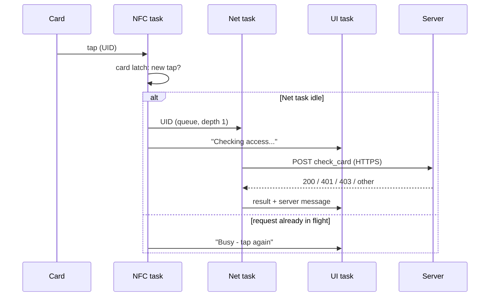

- Only one request is in flight at a time.
- The same card is processed again only after **3** empty polls in a row
  (removed). A different card is accepted right away.
- The reader polls only when the network is up, the terminal is configured and
  no OTA is running.

## Network loss and recovery

The terminal never needs a reboot to get back online. All checks run in the
Net task while no card request is in flight.

| Situation | Screen | What the terminal does |
|---|---|---|
| Cable unplugged / no link | `No Network (check cable)` | The W5500 driver polls the link every ~2 s. Plugging the cable in starts DHCP at once |
| Link up, no IP address | `No IP (waiting for DHCP)` | Waits 30 s for DHCP, then restarts the W5500 |
| No IP for 30 s (any reason) | as above | Restarts the W5500 every 30 s until an address is obtained (covers a module that failed to start or hung) |
| IP up, server unreachable | `Server unreachable - retrying` | After a connection error, tries a TCP connect to the server's host:port every 15 s (no HTTP request). The first answer returns the screen to **Ready**. Cards can still be tapped |
| Server unreachable for 5 min with link up | as above | Also restarts the W5500 (a stalled W5500 can keep its link and IP) |

Serial log lines: `[ETH] link down (cable?)`, `[ETH] link up`, `[ETH] IP ...`,
`[ETH] no IP for 30s (no link), restarting W5500`,
`[NET] server host:443 still unreachable`, `[NET] server host:443 reachable again`.
`/diag` shows `link_up`, `net_up`, `server_reachable`, and the counters
`net_restarts` and `server_probes`.

The Wi-Fi build reconnects by itself (`setAutoReconnect`); the server checks
work the same way there.

## Display and LED states

Screens are 200×200 BMP files from `images/`, loaded from LittleFS. Below the
image is a two-line footer:

- **Status line** (large, centred). When the terminal is ready for a card it
  shows its **IP address**, e.g. `192.168.100.11`.
- **Bottom line**: `IP: <address>` on the left and `github.com/0leg19` on the
  right (`FOOTER_BRAND` in `config.h`). On the ready screen the address is
  already the status line, so only `github.com/0leg19` is shown, centred.

| Screen | File | LED | When |
|---|---|---|---|
|  | `boot_logo.bmp` | white (after self-test) | Start-up |
| 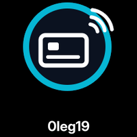 | `status_tap_card.bmp` | cyan | Ready: the terminal's **IP address** in the centre |
| 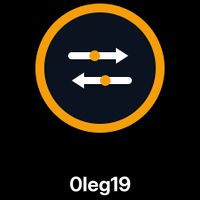 | `status_waiting.bmp` | cyan | **Checking access...** |
|  | `status_success.bmp` | green | HTTP 200: access granted (or the server's `message`) |
|  | `status_fail.bmp` | red | HTTP 401/403: access denied; also **NFC Error** |
| 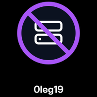 | `status_no_server.bmp` | red | **Server unreachable - retrying**; server error, connection or TLS error, invalid/missing URL, `HTTPS required` |
| 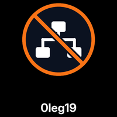 | `status_no_internet.bmp` | red | **No Network (check cable)**: no link |
|  | `status_no_ip.bmp` | red | **No IP (waiting for DHCP)**: link up, no address yet |
|  | `status_setup.bmp` | yellow | **Needs Config (App)**: network up, terminal not provisioned |
|  | `status_unknown.bmp` | yellow | Setup code, Wi-Fi setup AP, **Busy - tap again**, factory-reset hint |
| 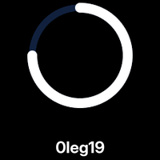 | `status_progress.bmp` | blue | **Updating firmware...**, factory reset |

Result screens stay for 2.5 s. Then the terminal returns to its base screen,
picked in this order: OTA running → setup code → NFC error → Wi-Fi setup AP →
no link → no IP → not configured → request in flight → server unreachable →
ready.

The network screens are technology-neutral (no Wi-Fi symbol). They are drawn by
[`firmware/tools/make_images.py`](firmware/tools/make_images.py)
(`python3 firmware/tools/make_images.py images`).

Non-ASCII characters in the server's `message` are shown as `?`; the text is
cut to 76 characters.

### All screens

Every screen the terminal can show. The images are rendered from the firmware's own drawing
code (240×320, same font, colours and layout) by
[`firmware/tools/render_screens.py`](firmware/tools/render_screens.py):

```bash
python3 firmware/tools/render_screens.py ~/Arduino/libraries/TFT_eSPI
```

\* The text comes from the server's `message` field when present; the default is shown.

#### Normal operation

<table>
<tr>
<td align="center" valign="top" width="25%"><br><sub>Start-up (boot logo)</sub></td>
<td align="center" valign="top" width="25%">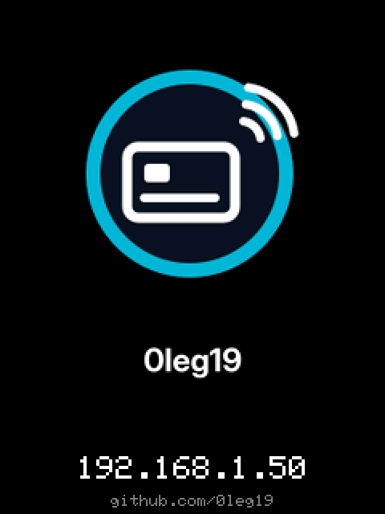<br><sub>Ready: tap a card (IP address)</sub></td>
<td align="center" valign="top" width="25%">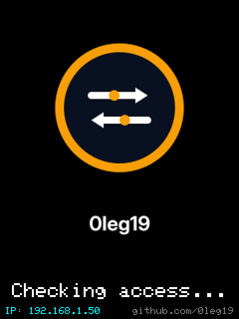<br><sub>Card read, waiting for the server</sub></td>
<td align="center" valign="top" width="25%">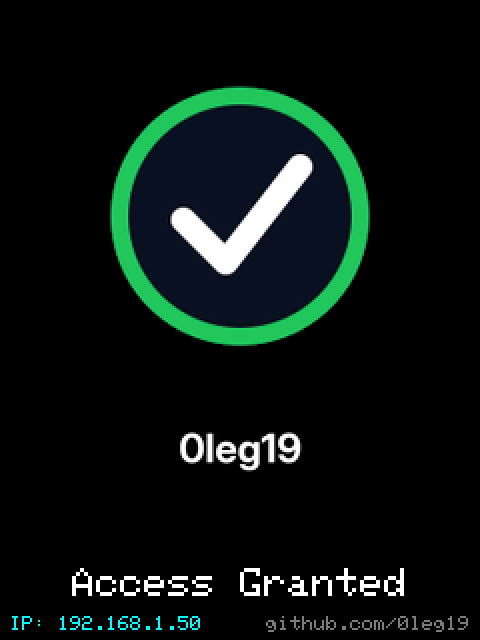<br><sub>HTTP 200: access granted*</sub></td>
</tr>
<tr>
<td align="center" valign="top" width="25%">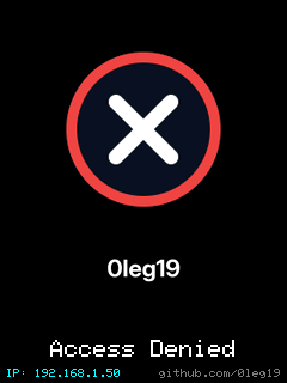<br><sub>HTTP 401/403: access denied*</sub></td>
<td align="center" valign="top" width="25%">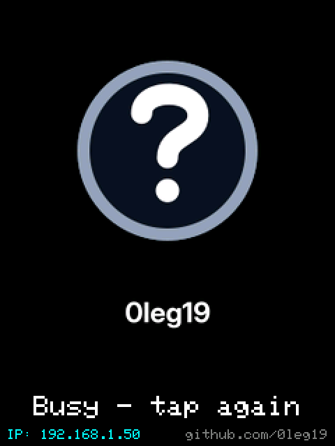<br><sub>Card tapped while a request is in flight</sub></td>
</tr>
</table>

#### Network and server

<table>
<tr>
<td align="center" valign="top" width="25%">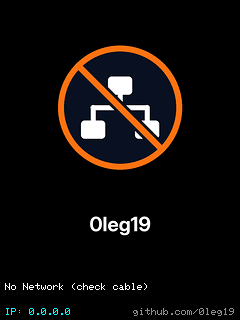<br><sub>No link: cable unplugged</sub></td>
<td align="center" valign="top" width="25%">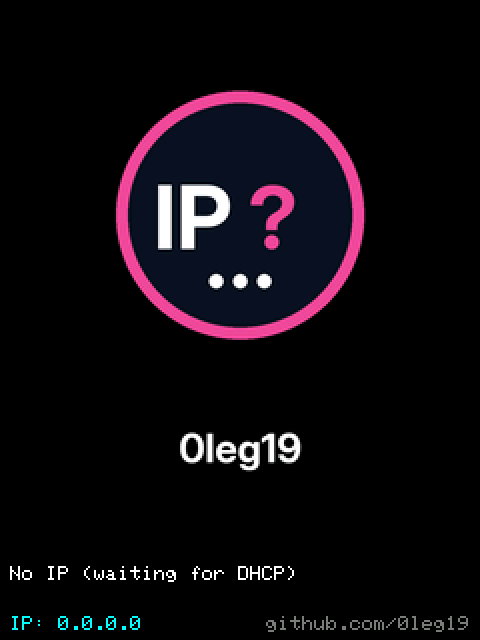<br><sub>Link up, waiting for DHCP</sub></td>
<td align="center" valign="top" width="25%">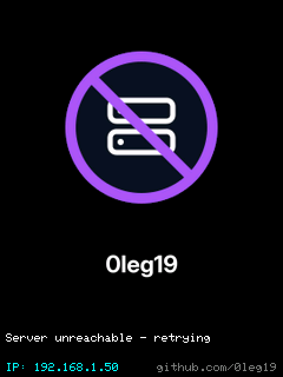<br><sub>Server unreachable, re-checked every 15 s</sub></td>
<td align="center" valign="top" width="25%">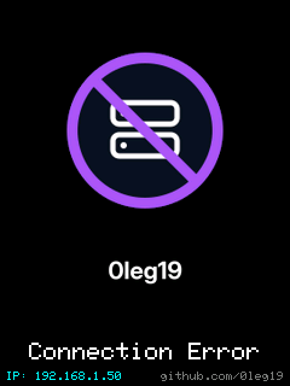<br><sub>No answer from the server</sub></td>
</tr>
<tr>
<td align="center" valign="top" width="25%">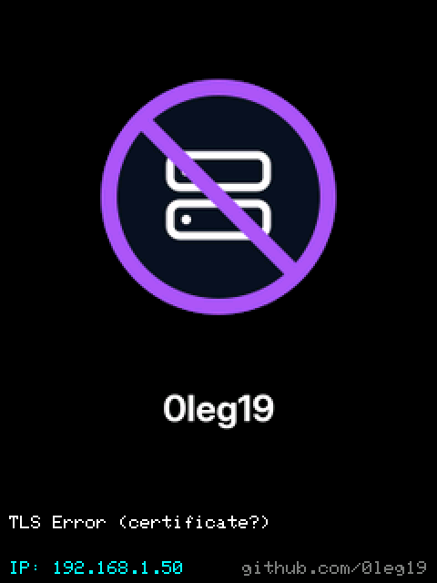<br><sub>Server certificate not trusted</sub></td>
<td align="center" valign="top" width="25%">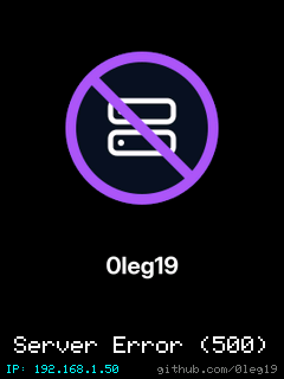<br><sub>Other HTTP status*</sub></td>
<td align="center" valign="top" width="25%">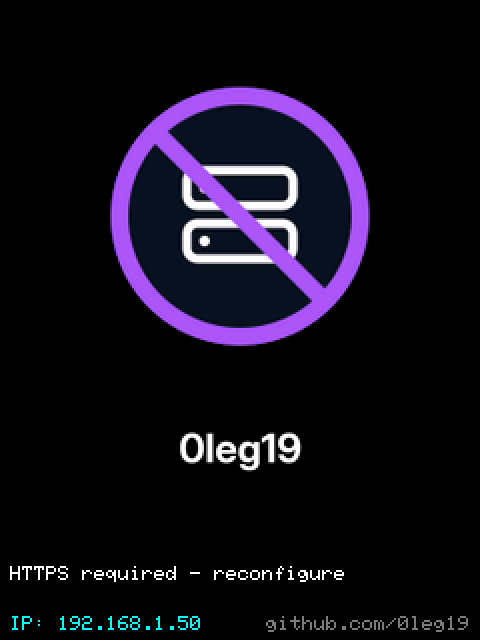<br><sub>Stored URL is http://</sub></td>
<td align="center" valign="top" width="25%">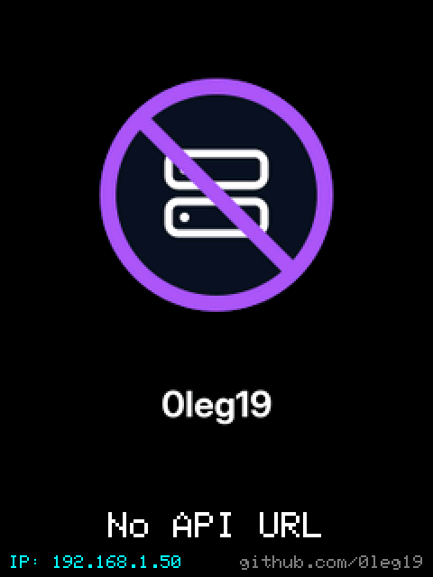<br><sub>No server URL configured</sub></td>
</tr>
<tr>
<td align="center" valign="top" width="25%">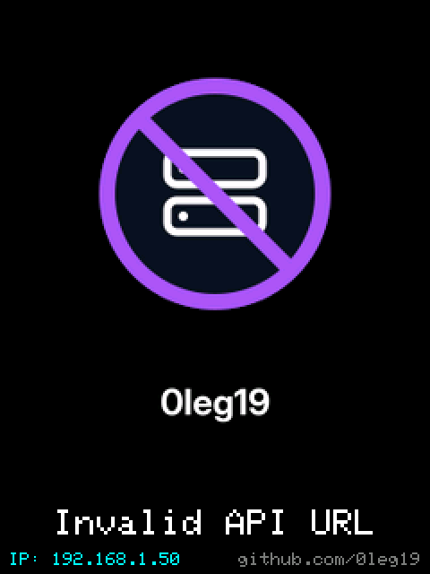<br><sub>URL cannot be used</sub></td>
</tr>
</table>

#### Setup and maintenance

<table>
<tr>
<td align="center" valign="top" width="25%">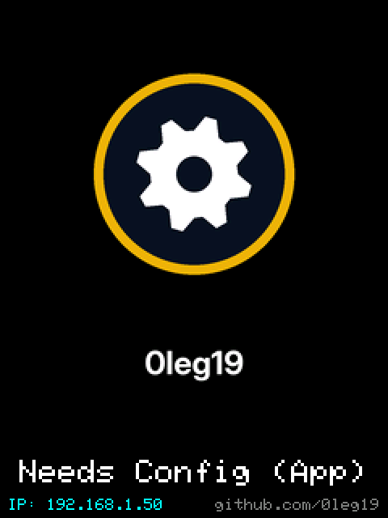<br><sub>Network up, not provisioned</sub></td>
<td align="center" valign="top" width="25%">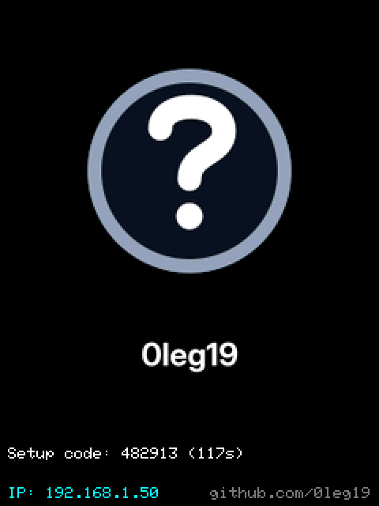<br><sub>One-time code after a short BOOT press</sub></td>
<td align="center" valign="top" width="25%">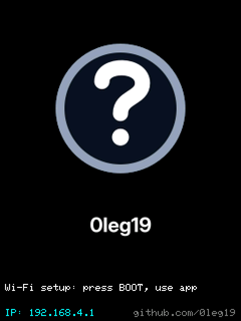<br><sub>Wi-Fi build without credentials (setup AP)</sub></td>
<td align="center" valign="top" width="25%"><br><sub>BOOT held 2 s</sub></td>
</tr>
<tr>
<td align="center" valign="top" width="25%">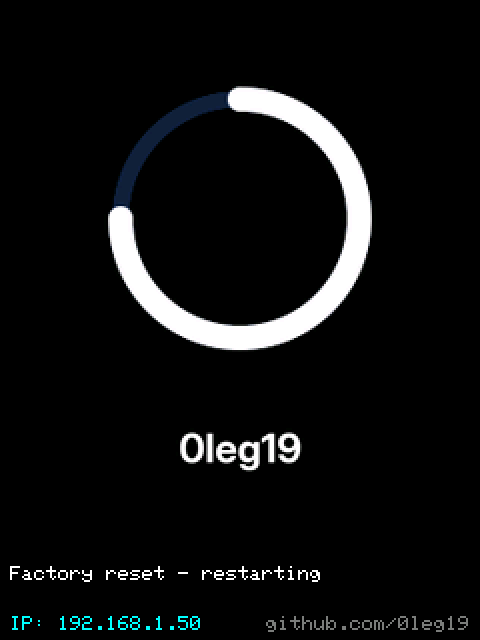<br><sub>BOOT held 5 s</sub></td>
<td align="center" valign="top" width="25%"><br><sub>Signed OTA update running</sub></td>
<td align="center" valign="top" width="25%">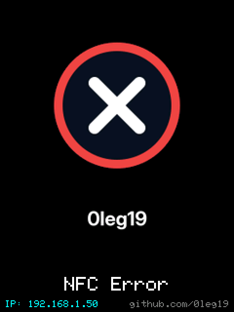<br><sub>PN532 not responding</sub></td>
</tr>
</table>

## BOOT button

Gestures are detected **while the firmware runs**. Holding GPIO0 while the chip
comes out of reset starts the ROM bootloader instead.

| Gesture | Action |
|---|---|
| Short press (50 ms – 2 s) | Opens the provisioning window: one-time code on the display for 120 s |
| Hold 2 s | Display warns: `Keep holding: factory reset` |
| Hold 5 s | **Factory reset**: configuration erased, restart |

## Local HTTP API

Port **80** on the terminal's IP. All responses are JSON.

| Method & path | Auth | Purpose |
|---|---|---|
| `GET /` | none | Identity and state |
| `POST /connect` | `otp` in body, or `Authorization: <barrier>` | Provisioning |
| `GET /diag` | `Authorization: <barrier>` | Counters, heap, stack margins |
| `POST /ota` | `Authorization` + `X-Signature` | Signed firmware update |

### `GET /`

```json
{
  "creator": "0leg19",
  "serial_number": "ESP32_RFID_A1B2C3D4E5F6",
  "software_version": "1.1.0",
  "model": "ESP32_RFID_001",
  "display": "ESP32_RFID_001",
  "unique_number": "…",
  "ip_address": "192.168.1.50",
  "connection": "ETHERNET",
  "nfc_status": "ready",
  "connection_status": "connected",
  "provisioning": "closed"
}
```

### `GET /diag`

Returns `software_version`, `uptime_s`, `heap_free`, `heap_min_free`,
`latch_k`, `link_up`, `net_up`, `server_reachable`, `stack_free_bytes` per task (`nfc`, `net`, `ui`, `api`, `sys`), and
`stats`: `polls`, `poll_hits`, `cards_admitted`, `cards_busy`, `requests`,
`http_200`, `http_401_403`, `http_other`, `conn_errors`, `last_latency_ms`,
`max_latency_ms`, `nfc_reinits`, `net_restarts`, `server_probes`.

### Errors

Errors look like `{"status":"error","message":"..."}`.

| Code | Meaning |
|---|---|
| 400 | Missing/invalid JSON or a field failed validation (message says which) |
| 401 | Missing or wrong `Authorization`, wrong code |
| 403 | Device not configured, setup window closed, too many wrong codes, bad OTA signature |
| 413 | Body larger than 6000 bytes |
| 429 | Locked out after 5 failures; retry after 60 s |
| 501 | OTA disabled (no public key in this build) |

## Server contract (`check_card`)

For every admitted card the terminal sends:

```http
POST <url>
Content-Type: application/json
x-api-key: <api_key>
Authorization: <barrier>

{"action":"check_card","uid":"04A1B2C3D4E5F6"}
```

`uid` is the card UID in upper-case hex.

| Server reply | Terminal shows |
|---|---|
| `200` | Green, `message` from the JSON body, or `Access Granted` |
| `401` / `403` | Red, `message`, or `Access Denied` |
| any other code | Red, `message`, or `Server Error (<code>)` |
| no reply / timeout (5 s) | `Connection Error` |
| TLS failure | `TLS Error (certificate?)` |

Optional reply body: `{"message":"Welcome, Nino"}`.

## Signed OTA updates

1. Create a key pair once and keep the private key **off** the device and out
   of this repository (`*.pem` is git-ignored):

   ```bash
   openssl ecparam -name prime256v1 -genkey -noout -out ota_private.pem
   openssl ec -in ota_private.pem -pubout -out ota_public.pem
   ```

2. Paste `ota_public.pem` into `OTA_PUBLIC_KEY_PEM` in
   [`api_task.cpp`](firmware/nfc_terminal/api_task.cpp) and flash once over USB.
3. Then update over the network:

   ```bash
   firmware/tools/ota_sign_and_upload.sh build/nfc_terminal.ino.bin ota_private.pem <terminal-ip> <barrier>
   ```

The script signs the image (ECDSA P-256 / SHA-256, DER, hex in `X-Signature`)
and uploads it as multipart field `firmware`. The terminal hashes the image
while writing it, checks the signature, and only then switches the boot
partition and restarts. A wrong signature is rejected; the running firmware
stays.

## NFC Terminal Manager (configuration and test app)

[`app/`](app/) contains a web app for managing **many terminals at once**. It
is a React + Tailwind CSS UI with a small Node.js backend, available in English
(default), Georgian, French, German, Spanish, Chinese and Arabic.

```bash
cd app && npm install && npm run dev     # http://localhost:5180
```

- **Terminals**: a table of all terminals with live status and KPIs, network
  scan, and bulk configuration / firmware update of selected terminals.
- **One page per terminal**: overview, configuration, diagnostics, firmware.
- **Tools**: a local HTTPS `check_card` test server (own CA, per-card rules,
  fault simulation, live log), OTA signing keys, serial log (Web Serial).
- **Integration**: API contract and example servers.

Details: [app/README.md](app/README.md).

<table>
<tr>
<td width="50%">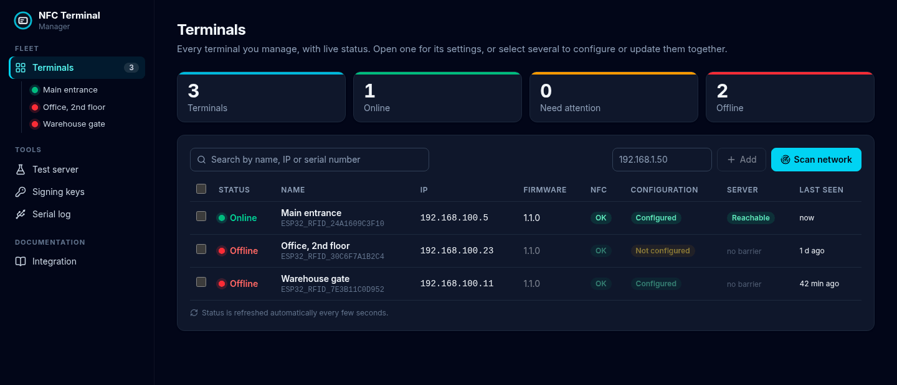</td>
<td width="50%">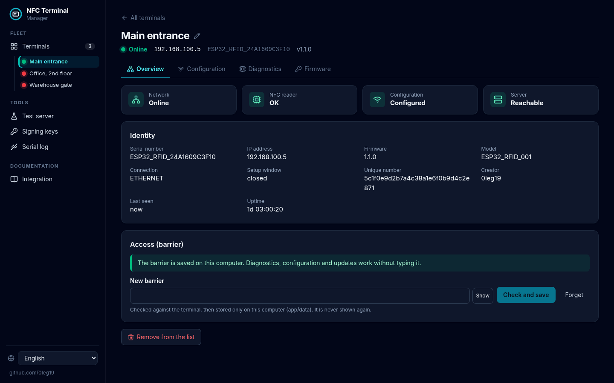</td>
</tr>
<tr>
<td>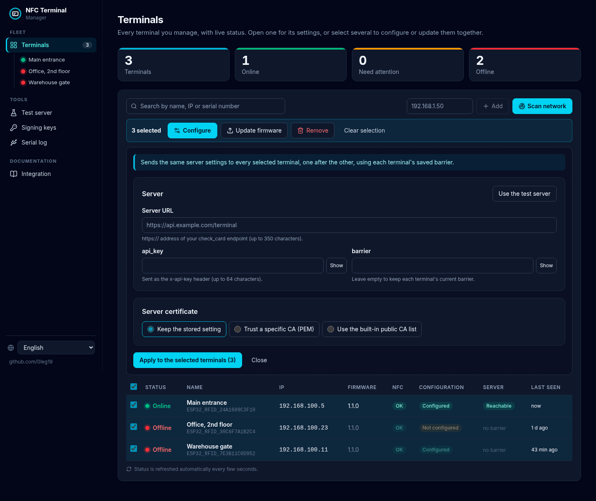</td>
<td>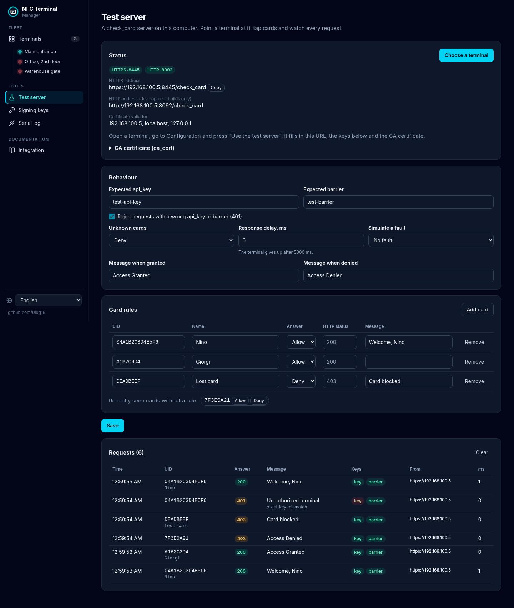</td>
</tr>
<tr>
<td>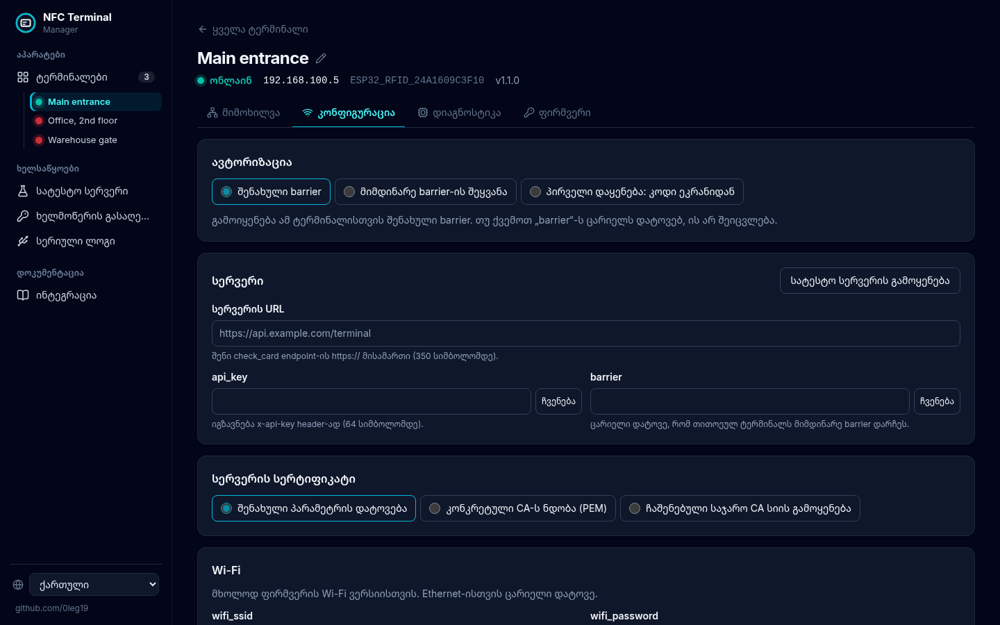</td>
<td>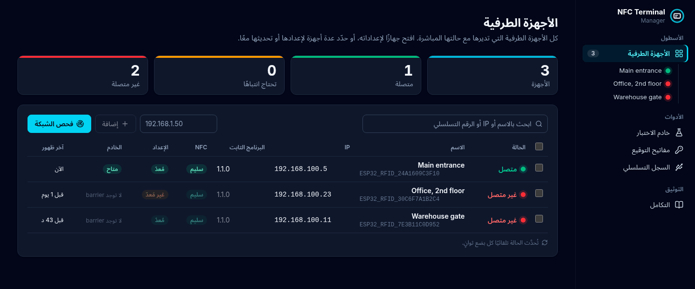</td>
</tr>
</table>

## Firmware architecture

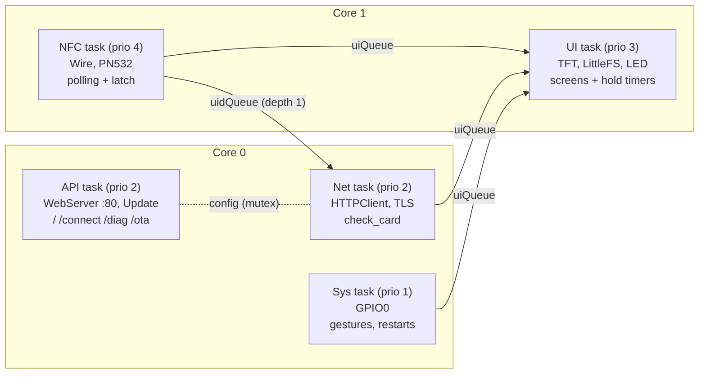

| Task | Core / prio | Stack | Owns | Job |
|---|---|---|---|---|
| `nfc` | 1 / 4 | 4 KB | Wire, PN532 | Polling, UID-aware latch, health check |
| `ui` | 1 / 3 | 6 KB | TFT, LittleFS, LED | Screens; results held by a timer, not `delay()` |
| `net` | 0 / 2 | 12 KB | HTTPClient, TLS | `check_card` request |
| `api` | 0 / 2 | 10 KB | WebServer :80, Update | Local API, OTA |
| `sys` | 0 / 1 | 3 KB | GPIO0 | BOOT gestures, scheduled restarts |

- Tasks talk only through queues and guarded accessors in
  [`app_state.h`](firmware/nfc_terminal/app_state.h). No task calls a driver
  owned by another task.
- NFC and UI are the user-facing loop and run above Net on core 1, so a slow
  server can never delay feedback for the next card.
- Every task is on the 30 s task watchdog; a hung task resets the device.
- The W5500 has its own HSPI bus, the display uses VSPI, so they cannot corrupt
  each other's transfers.
- Configuration is stored in NVS (namespace `nfcterm`).
- `card_latch.h` and `provisioning.h` are plain C++ without Arduino
  dependencies, so the same code runs on the device and in the host tests.

## Security

| Topic | Behaviour |
|---|---|
| TLS | Certificate always verified: provisioned `ca_cert`, else built-in CA bundle |
| `http://` URLs | Rejected unless built with `ALLOW_PLAIN_HTTP=1` |
| `/connect` | Needs the current barrier or the one-time code from the display |
| Secret comparison | Constant-time |
| One-time code | 6 digits, uniform (rejection sampling), 120 s, single use, max 5 tries |
| Brute force | 5 failures → 60 s lock-out (barrier, OTP and OTA) |
| Header injection | Control characters in `url`/`api_key`/`barrier` rejected |
| Wi-Fi credentials | Provisioned, never in source code |
| Identity | Derived from the chip's MAC, unique per unit |
| Firmware updates | ECDSA P-256 signed only |

**Not done in code (device-level settings):**

- **Flash encryption, NVS encryption and Secure Boot** are eFuse settings set
  with `espefuse.py`/`idf.py`. A sketch cannot enable them, and they cannot be
  undone. Recommended for production, after testing.
- Cryptographic cards (e.g. DESFire) need reader-protocol work; the terminal
  uses the UID only.

## Tests

Host-side tests for the pure C++ parts, built with AddressSanitizer and UBSan:

```bash
cd firmware/tests
g++ -std=c++17 -O2 -Wall -Wextra -fsanitize=address,undefined -I../nfc_terminal provisioning_test.cpp -o provisioning_test && ./provisioning_test
g++ -std=c++17 -O2 -Wall -Wextra -fsanitize=address,undefined -I../nfc_terminal latch_test.cpp -o latch_test && ./latch_test
```

Last results (logs in [`firmware/tests/`](firmware/tests/)):

| Test | Result |
|---|---|
| `provisioning_test` | 201 073 checks, 0 failures |
| `latch_test` | 8 000 000 random steps, 8 000 016 checks, 0 failures |

Discrete-event model of the NFC task (duplicate requests for a card left on
the reader, as a function of the per-poll miss probability `p` and the
threshold `K`; fixed seed, so the numbers are reproducible):

```bash
python3 firmware/tests/latch_sim.py results
```

## Checks after flashing

1. Serial (115200) shows `[NFC] PN532 ...`, `[ETH] IP ...`,
   `[API] HTTP server on port 80`.
2. `GET /` returns this unit's own `serial_number`.
3. Provision with the BOOT code; tap a card → green or red.
4. Two different cards back to back → both are processed.
5. Stop the server → `Connection Error`, then `Server unreachable - retrying`;
   `GET /` still answers. Start the server → back to **Ready** within ~15 s.
6. `GET /diag` with `Authorization` → every task's `stack_free_bytes` > 500.
7. Unplug the cable → `No Network (check cable)`. Plug it back in → IP and
   **Ready** within a few seconds, no reboot.

## Troubleshooting

| Symptom | Check |
|---|---|
| `NFC Error` / `[NFC] PN532 not found` | DIP switch 1 = ON, 2 = OFF; SDA→21, SCL→22, IRQ→33 connected; the I2C scan on serial should list `0x24` |
| `No Network (check cable)` | Cable and link LED on the W5500; W5500 on 3V3, not VIN |
| `No IP (waiting for DHCP)` | DHCP server on the LAN; `net_restarts` in `/diag` grows every 30 s while it lasts |
| `Server unreachable - retrying` | Server down, wrong host/port, firewall; serial shows each probe |
| Board restarts by itself | Power: W5500 draws up to ~130 mA. Use a separate 3.3 V supply with common GND |
| Black screen / no icons | `User_Setup.h` copied into TFT_eSPI; BMPs uploaded to LittleFS root (`[UI] LittleFS mounted` on serial) |
| `TLS Error (certificate?)` | Server certificate not trusted: provision its CA in `ca_cert` |
| `HTTPS required - reconfigure` | Stored URL is `http://`: provision `https://`, or build with `ALLOW_PLAIN_HTTP=1` |
| `Busy - tap again` | The previous request is still waiting for the server (up to 5 s + TLS) |
| `/connect` returns 429 | 5 failed attempts: wait 60 s |
| `/ota` returns 501 | No public key compiled in `api_task.cpp` |
| G/B of the LED do nothing | ESP32-**WROVER** module: GPIO16/17 belong to PSRAM |

## License

[MIT](LICENSE) © 2026 Olegi Iremadze
