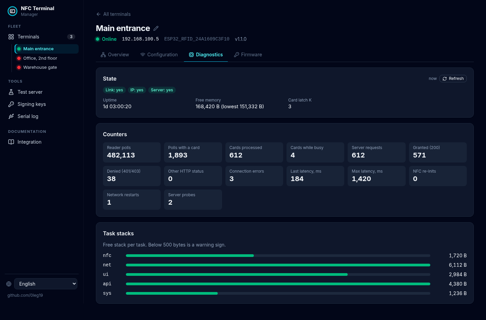
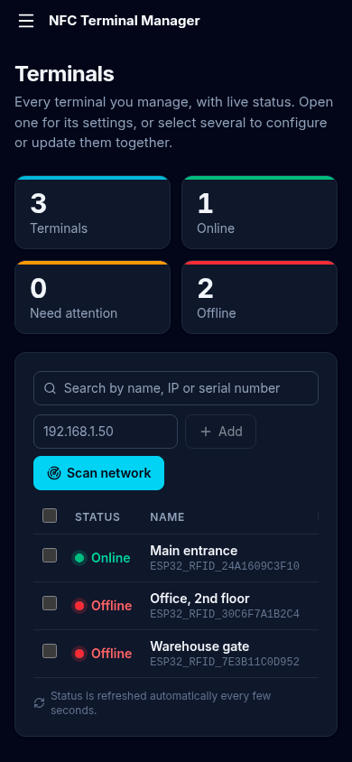

# NFC Terminal Manager

Desktop web app for **managing many ESP32 NFC terminals at once**: configuration,
diagnostics, firmware updates, a local test server and the integration guide.
React + TypeScript + Tailwind CSS UI with a small Node.js backend, in 7
languages: English (default), ქართული, Français, Deutsch, Español, 中文,
العربية (right-to-left).


## Start

Requires **Node.js 22.18 or newer** (TypeScript runs natively, no build step for the backend).

```bash
cd app
npm install
npm run dev        # development, hot reload
# or
npm run build && npm start   # production build
```

Open **http://localhost:5180**. The UI and its API listen on `127.0.0.1` only.

| Variable | Default | Meaning |
|---|---|---|
| `PORT` | `5180` | UI and API port (loopback) |
| `MOCK_HTTPS_PORT` | `8443` | Test server, HTTPS (all interfaces) |
| `MOCK_HTTP_PORT` | `8090` | Test server, plain HTTP (all interfaces) |
| `NFC_DATA_DIR` | `app/data` | Keys, certificates and test-server settings |

The terminal must be able to reach this computer on the test-server ports
(allow them in the firewall if needed).

## Layout

A fixed sidebar on the left (a drawer on phones) has three groups:

| Group | Page | What it does |
|---|---|---|
| Fleet | **Terminals** | Table of all managed terminals with live status, KPI cards (total / online / need attention / offline), search, network scan, add by IP. Select several terminals to **configure them together**, **update their firmware together** or remove them; each terminal gets its own result line. The sidebar also lists the terminals with a status dot. |
| | **Terminal page** (one per terminal) | Tabs: **Overview** (status tiles, identity, name, saved barrier), **Configuration** (`POST /connect`), **Diagnostics** (`/diag`: link / IP / server, counters, task stacks), **Firmware** (signed OTA for this terminal). |
| Tools | **Test server** | A `check_card` server on this computer (see below), with per-card rules, fault simulation and a live log of every request. |
| | **Signing keys** | Creates the ECDSA P-256 key and shows the public key as C code for `api_task.cpp`. |
| | **Serial log** | The USB log of a terminal in the browser (Web Serial: Chrome / Edge). |
| Documentation | **Integration** | The `check_card` contract, response table, example servers (Node.js, Python, PHP) and the terminal's local API. |

### How terminals are tracked

- Terminals are identified by **serial number** (derived from the chip's MAC),
  so a terminal that gets a new IP from DHCP is found again by *Scan network*.
- The backend polls every terminal every 5 s (`GET /`, plus `GET /diag` when a
  barrier is saved). The browser refreshes the list every 3 s.
- **Barriers** are checked against the terminal before they are saved, stored
  in `app/data/terminals.json` (mode `0600`) and never sent back to the
  browser. A barrier the terminal rejects is marked and not used again until
  it is replaced, so background polling can never trigger the terminal's
  5-failure lock-out.
- Bulk configuration and bulk updates run one terminal after the other and use
  each terminal's saved barrier. Terminals that are offline, not configured or
  have no saved barrier are skipped with a reason. Leaving *barrier* empty
  keeps each terminal's current one.

| | |
|---|---|
|  |  |
|  |  |

## Test server

The terminal accepts only HTTPS with a verified certificate. The app creates
its own **certificate authority** on first start (`app/data/ca.crt`) and a
server certificate for every LAN address of this computer (IP as `iPAddress`
and `dNSName`). The certificate is re-issued automatically when the addresses
change; the CA stays the same, so a terminal provisioned once keeps working.

Typical end-to-end test:

1. **Terminals** → open the terminal → **Configuration** tab.
2. *Use the test server* (fills URL, keys and `ca_cert`) → choose the saved
   barrier, the current barrier or the setup code → *Save to terminal*.
3. **Test server** → tap cards. Unknown UIDs appear under *Recently seen cards*;
   allow or deny them with one click. Try *Simulate a fault* (500, timeout,
   closed connection) and a response delay to see the terminal's error screens.

Requests are checked like a real server would: `x-api-key` and `Authorization`
must match the expected values (else 401), the body must be
`{"action":"check_card","uid":...}`.

## Security

- UI and API bind to `127.0.0.1`; requests with a foreign `Host` or `Origin`
  header are rejected (DNS rebinding / cross-site requests).
- The backend talks only to **private IPv4 addresses** (10/8, 172.16/12,
  192.168/16, 169.254/16), so it cannot be used as an open proxy.
- Private keys (CA, server, OTA) and saved barriers are stored with mode
  `0600` in `app/data/`, which is git-ignored. Barriers are never returned to
  the browser.

## Development

```bash
npm run typecheck   # tsc
npm test            # node --test: fleet logic, test server over HTTPS, OTA signatures, translations
```

```
app/
├── server/            Node backend (TypeScript, run directly by Node)
│   ├── index.ts       Express app, API routes, Vite middleware / static files
│   ├── fleet.ts       managed terminals, background polling, saved barriers
│   ├── terminal.ts    terminal API client, network scan
│   ├── mock.ts        check_card test server
│   ├── pki.ts         CA and server certificate (node-forge)
│   ├── ota.ts         ECDSA P-256 signing
│   └── *.test.ts
└── src/               React UI (Tailwind CSS)
    ├── pages/         Terminals, Terminal (tabs), TestServer, Signing, SerialLog, Integration
    ├── components/    shared UI (ui.tsx) and the configuration form (settings.tsx)
    ├── locales/       en, ka, fr, de, es, zh, ar
    └── i18n.ts        i18next setup, RTL switch
```

Adding a language: copy `src/locales/en.json`, translate the values, add it to
`LANGUAGES` and `resources` in `src/i18n.ts`. `npm test` checks that every
language has the same keys and `{{placeholders}}` as English.
